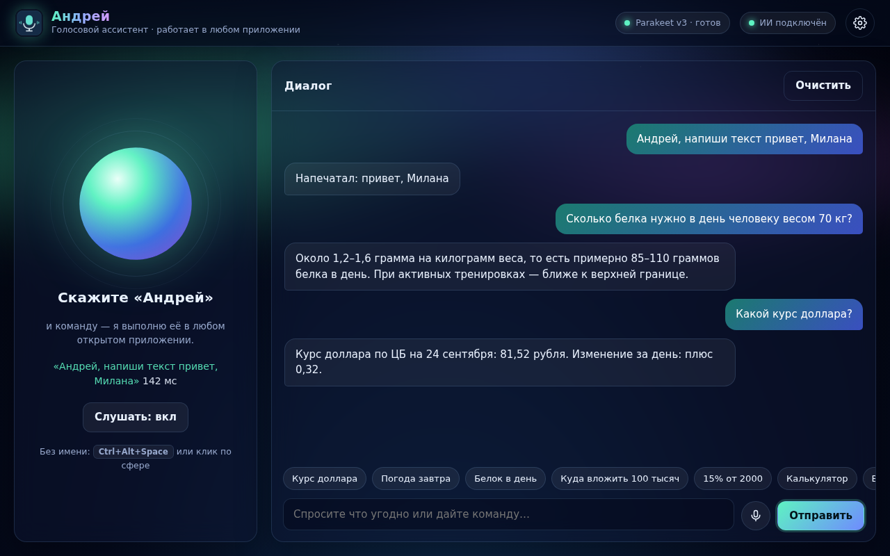
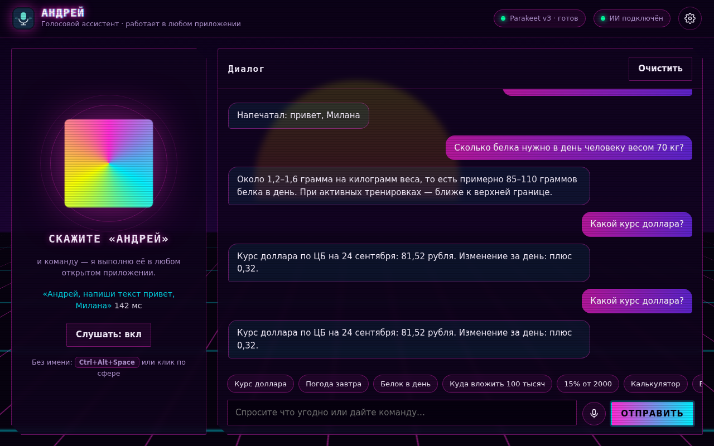
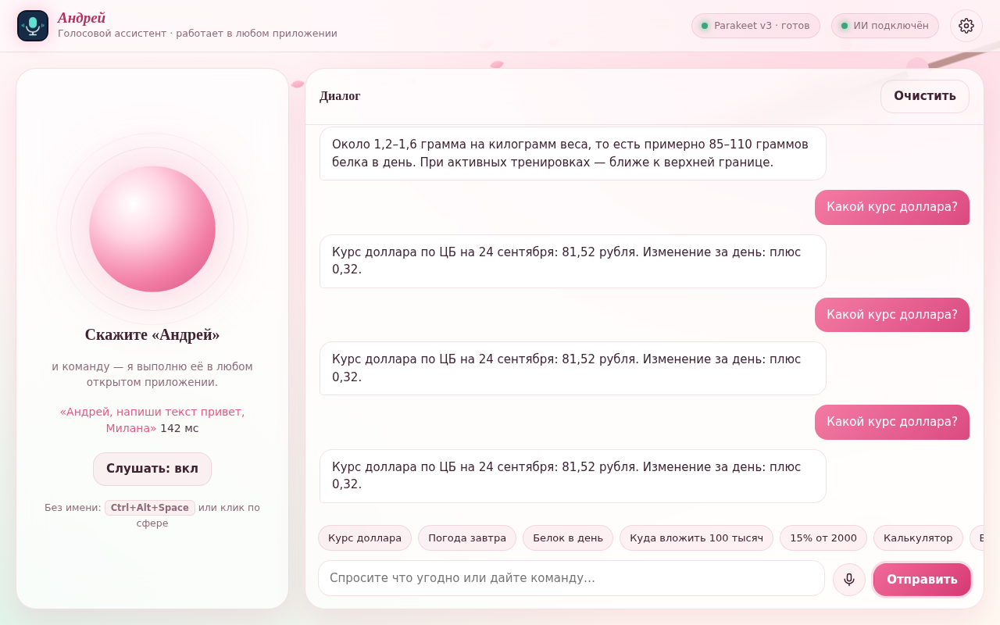
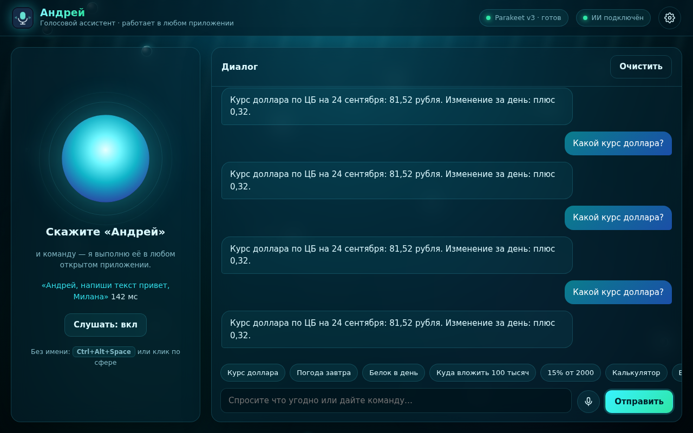
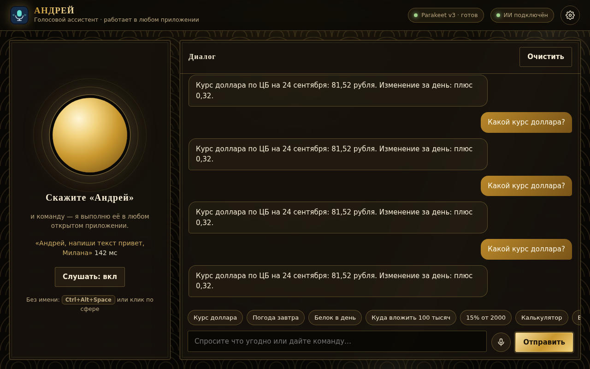
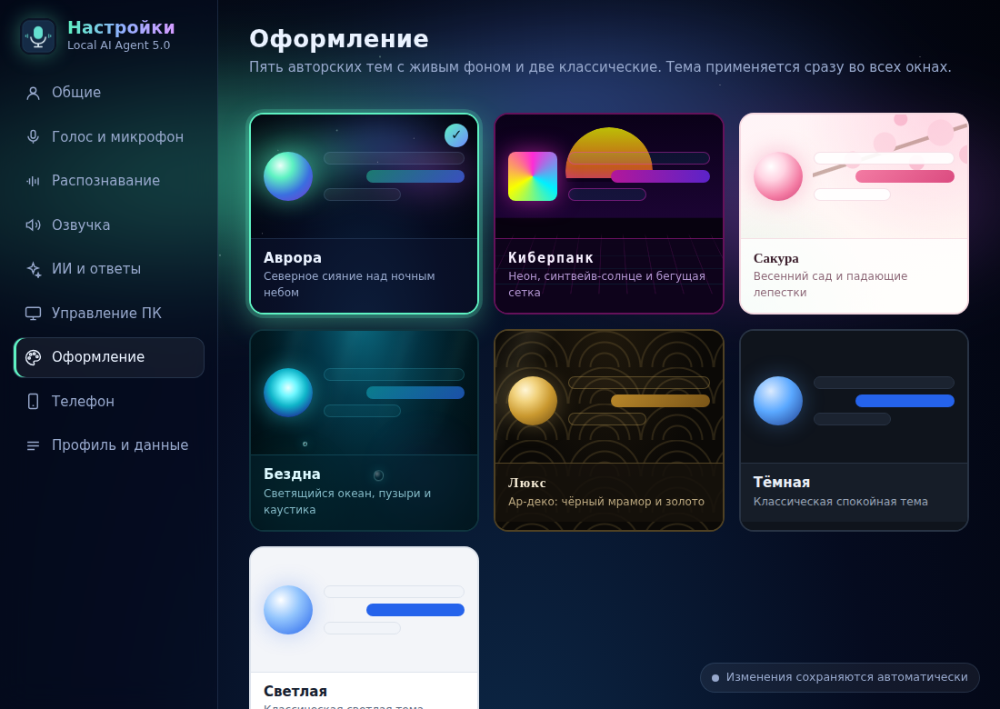

# Local AI Agent 5.0 — голосовой ассистент «Андрей» для Windows

Ассистент постоянно слушает микрофон в фоне и реагирует на своё имя: **«Андрей, …»**.
Команды выполняются в **любом открытом приложении**: Word, Telegram, браузере, Блокноте,
Discord и других. Можно спросить что угодно, от курса доллара до вопросов о питании и финансах.

| Аврора | Киберпанк | Сакура |
|---|---|---|
|  |  |  |
| **Бездна** | **Люкс** | **Окно настроек** |
|  |  |  |

## Быстрый старт

1. Установите Python 3.12 x64 с python.org (с Python Launcher) и WebView2 Runtime (в Windows 11 он уже есть).
2. Запустите `SETUP_WINDOWS.bat`. Он поставит зависимости и один раз скачает модели:
   Parakeet v3 (≈670 МБ), GigaAM v3 (≈230 МБ), Silero VAD и голоса Piper.
3. Запустите `START_WINDOWS.vbs`.
4. Откройте **⚙ Настройки → ИИ и ответы** и вставьте ключ Anthropic API
   ([console.anthropic.com](https://console.anthropic.com)). Без ключа работают команды,
   курсы валют, погода, калькулятор и разговорные ответы.

Сборка установщика: `BUILD_WINDOWS.bat` (нужен Inno Setup 6) → `installer\LocalAIAgent_Setup.exe`.

## Что умеет

**Команды в любом приложении** (фраза «Андрей, …» или горячая клавиша `Ctrl+Alt+Пробел` без имени):

| Скажите | Что произойдёт |
|---|---|
| «Андрей, напиши текст привет, Милана» | текст появится в активном окне: Word, чат Telegram, браузер… |
| «Напиши и отправь я уже еду» | напечатает и нажмёт Enter |
| «Напиши Милане в Телеграме привет» | откроет Telegram, найдёт чат «Милан…», напечатает сообщение |
| «Отправь», «Новая строка», «Сотри слово», «Очисти поле» | действия с полем ввода |
| «Выдели всё», «Скопируй», «Вставь», «Отмени», «Сохрани», «Жирный» | работа с текстом и документами |
| «Сочини поздравление для Миланы» | ИИ сочинит текст и напечатает его |
| «Переведи выделенное на английский», «Исправь ошибки», «Прочитай выделенное» | ИИ обработает выделенный текст |
| «Начни диктовку» … «Стоп диктовка» | всё сказанное печатается в активное окно |
| «Нажми Ctrl+Shift+T», «Нажми вниз 3 раза» | любые сочетания клавиш |
| «Сверни окно», «Разверни окно», «Закрой окно», «Покажи рабочий стол» | управление окнами |
| «Громче», «Тише», «Следующий трек», «Пауза музыки», «Сделай скриншот» | звук, музыка, экран |
| «Открой Telegram», «Закрой Chrome», «Включи видео котики», «Открой YouTube» | программы и сайты |

**Вопросы.** Самые частые ответы берутся прямо из первоисточников и приходят за доли секунды:
курсы ЦБ РФ и конвертация («100 евро в рублях»), погода Open-Meteo («погода завтра в Казани»),
криптовалюты CoinGecko, калькулятор («15% от 2000», «двадцать пять умножить на четыре»),
время и дата. Все остальные вопросы («сколько белка нужно в день», «куда вложить 100 тысяч»)
обрабатывает Claude с веб-поиском. Ответ начинает звучать, пока модель ещё дописывает текст.
Ассистент помнит несколько последних реплик, поэтому работает уточнение вроде «а в евро?».

## Скорость и точность

| Этап | Было (4.0) | Стало (5.0) |
|---|---|---|
| Запись | браузер, пауза 1,2 с, webm → сервер | нативный микрофон, Silero VAD, пауза 0,6 с (настраивается) |
| Распознавание | Whisper small, beam 5, CPU: 4–7 с на фразу | Parakeet v3 / GigaAM v3 (ONNX int8): RTFx 36–59 на CPU, то есть ~0,1–0,4 с на фразу |
| Точность русского | Whisper small | GigaAM v3 / Parakeet v3: заметно ниже WER на русском |
| Ответ | только шаблоны; баг: всё уходило в «Не понял команду» | мгновенные ответы из первоисточников + потоковый ИИ, озвучка по предложениям |
| Работа в фоне | только при открытом окне | трей, фоновое прослушивание, глобальная горячая клавиша |

RTFx взяты из бенчмарков [onnx-asr](https://github.com/istupakov/onnx-asr). На вашем ПК время
последней фразы показано в настройках (раздел «Распознавание») и под сферой в главном окне.

Движок выбирается автоматически: режим «Русский + английский» использует Parakeet v3 с автоопределением
языка, режим «Только русский» — GigaAM v3 (максимальная точность, сразу с пунктуацией). На видеокартах
NVIDIA можно выбрать резервный Whisper large-v3-turbo: `python scripts\download_model.py whisper`.

## Устройство

```
main.py                 окно, трей, горячая клавиша, фоновый голос, окно настроек
app.py                  локальный API (Flask + SSE), общий для ПК, окна настроек и телефона
src/speech/             распознавание: engines (Parakeet/GigaAM/Whisper), vad, microphone, wake, voice_loop
src/brain/              ответы: quick (курсы/погода/калькулятор), llm (Claude, OpenAI-совместимые), tools
src/desktop/            любое приложение: winapi (SendInput), controller, commands, messengers, hotkey
src/tts_player.py       озвучка Piper по предложениям, мгновенная остановка
src/service.py          единая точка выполнения команд (текст, голос, телефон)
templates/, static/     главное окно, отдельное окно настроек, 7 тем
```

Данные и модели хранятся в `%LOCALAPPDATA%\LocalAIAgent`. Ключи API хранятся только там
и никогда не отдаются через `/api/settings`.

## Проверка

```bat
.venv\Scripts\python.exe -m unittest discover -s tests -v
.venv\Scripts\python.exe tests\browser_smoke.py
```

## Приватность

Речь распознаётся локально. Если включён ИИ, в Anthropic отправляется текст вопроса
(не аудио). Команды управления ПК, калькулятор и разговорные ответы работают без интернета.
Курсы, погода и криптовалюты запрашиваются у открытых сервисов без ключей.
