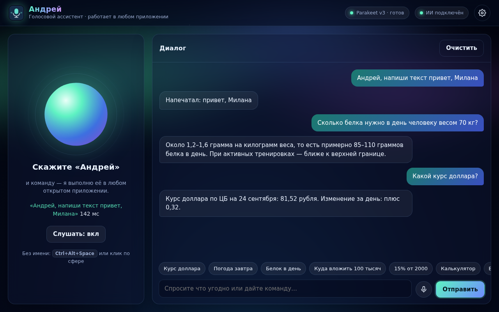
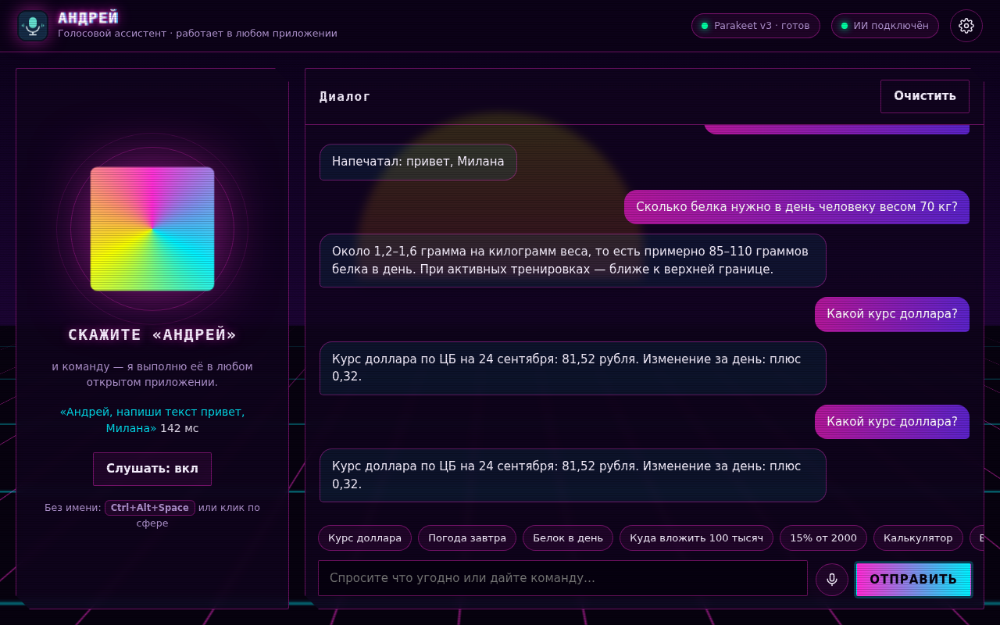
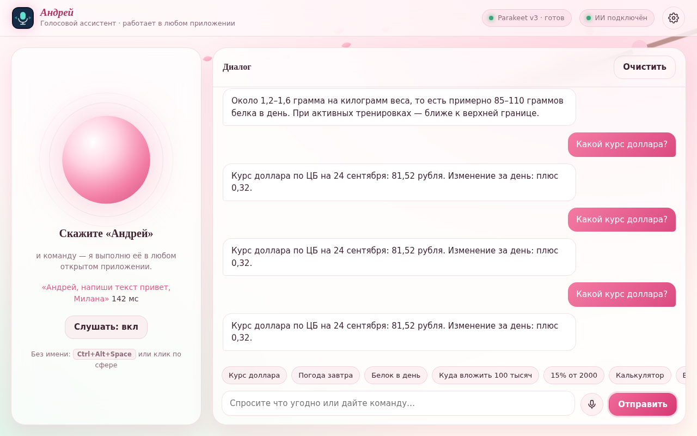
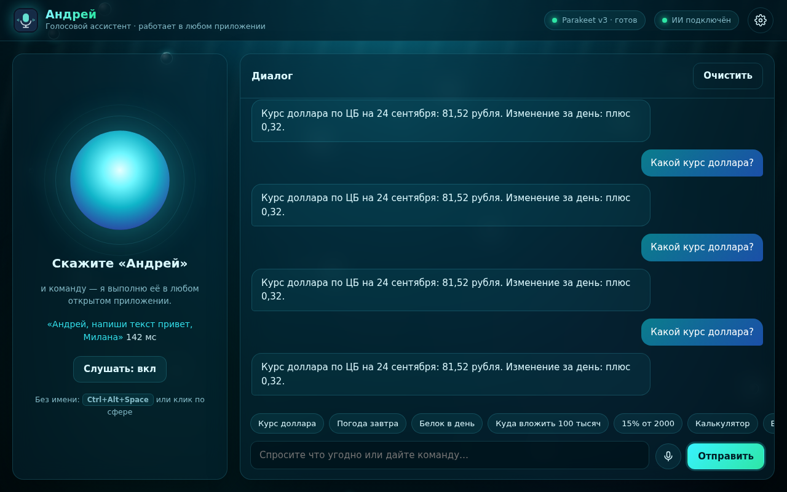
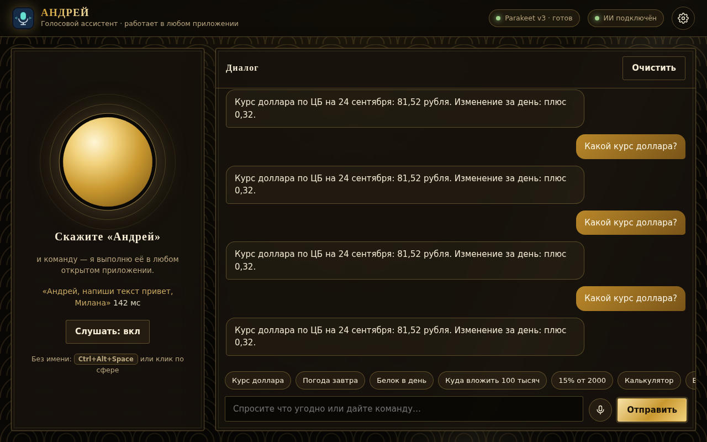
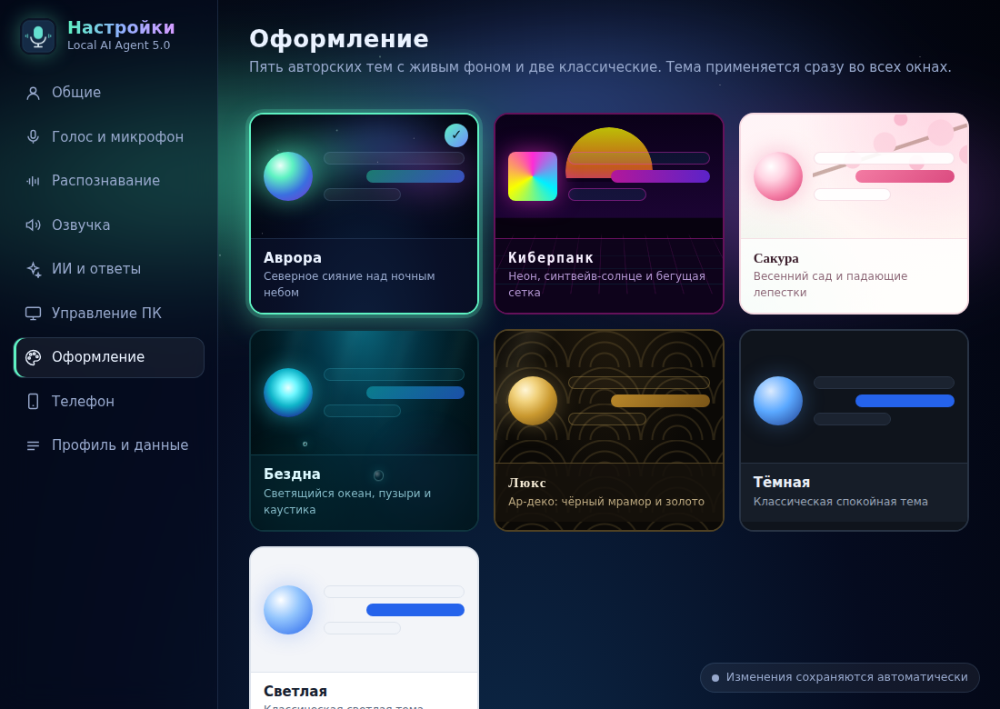

# Local AI Agent 5.7 — голосовой ассистент «Андрей» для Windows, macOS и iPhone

Ассистент постоянно слушает микрофон в фоне и реагирует на своё имя: **«Андрей, …»**.
Команды выполняются в **любом открытом приложении**: Word, Telegram, браузере, Блокноте,
Discord и других. Можно спросить что угодно, от курса доллара до вопросов о питании и финансах.

**Всё бесплатно и без ключей.** Распознавание речи, голос и нейросеть для ответов работают прямо
на вашем компьютере. Интернет нужен только для свежих данных (курсы Банка России, погода MET Norway,
справка из Википедии) и один раз — чтобы скачать модели. Все источники данных разрешают
коммерческое использование с указанием авторства; список — на странице **Настройки → Лицензии**.

| Аврора | Киберпанк | Сакура |
|---|---|---|
|  |  |  |
| **Бездна** | **Люкс** | **Окно настроек** |
|  |  |  |

**Новое в 5.1:** кнопка «Пауза», YouTube голосом в одном окне («Открой первое видео»),
ответы «Да, сэр, включаю…», уточняющие вопросы («Что открыть, сэр?»), любые чаты и группы Telegram,
аккаунт и подписка, версия для macOS и iPhone. Подробно — [docs/CHANGES_v5.md](docs/CHANGES_v5.md).

## Быстрый старт

1. Установите Python 3.12 x64 с python.org (с Python Launcher) и WebView2 Runtime (в Windows 11 он уже есть).
2. Запустите `SETUP_WINDOWS.bat`. Он поставит зависимости и один раз скачает модели:
   Parakeet v3 (≈670 МБ), GigaAM v3 (≈230 МБ), Silero VAD, голоса Piper,
   движок llama.cpp и нейросеть Qwen3 4B (≈2,5 ГБ). Всего около 4 ГБ.
3. Запустите `START_WINDOWS.vbs`. Больше ничего настраивать не нужно.

Нужно 8 ГБ оперативной памяти (для Qwen2.5 7B — 16 ГБ). Если есть видеокарта, включите
**Настройки → ИИ → Ускорение видеокартой**: ответы станут в несколько раз быстрее.

**macOS:** `./SETUP_MAC.sh`, затем `./START_MAC.command`; готовый `.dmg` — `./BUILD_MAC.sh`.
**iPhone:** Настройки → «iPhone и Android» → QR-код; голосом — «Привет, Siri, Андрей».
Подробно: [docs/MAC_IPHONE.md](docs/MAC_IPHONE.md).

**Android:** `BUILD_ANDROID.bat` собирает `release\LocalAIAgent.apk` и `release\LocalAIAgent.aab` для Google Play и RuStore — см. [docs/ANDROID_STORES.md](docs/ANDROID_STORES.md).
**Расширение для браузера** (Chrome, Edge, Яндекс Браузер, Opera): ассистент работает в вашем открытом браузере —
Настройки → Управление ПК → «Расширение „Андрей“». **Интеграции** с другими приложениями — [docs/INTEGRATIONS.md](docs/INTEGRATIONS.md).
**Голоса** «Джарвис» и «Пятница», свой голос — [docs/VOICES.md](docs/VOICES.md). **Оплата через Т-Банк** — [docs/TBANK.md](docs/TBANK.md).
**Отправить другу на Mac, имея только Windows:** сборку делает GitHub — [docs/MAC_FOR_FRIEND.md](docs/MAC_FOR_FRIEND.md).

## Установщик «всё в одном» для пользователей

`BUILD_WINDOWS.bat` (нужен Inno Setup 6) собирает установщик, внутри которого уже есть всё:
программа, распознавание речи, голоса, движок llama.cpp и нейросеть. Пользователю не нужны
Python, интернет и загрузки — он запускает установщик, и ассистент сразу работает.

- Размер ≈ 4–4,5 ГБ, поэтому установщик делится на части: `LocalAIAgent_Setup.exe` +
  `LocalAIAgent_Setup-1.bin`, `-2.bin`… Раздавайте их вместе (одной папкой или zip-архивом).
- Установщик меньше на 1,4 ГБ: перед сборкой `set BUNDLE_LLM=qwen3-1.7b`.
- Совсем маленький установщик без нейросети: `set BUNDLE_LLM=none` — тогда нейросеть скачается
  сама при первом запуске, с прогрессом в главном окне.

Если чего-то не хватает (например, программа запущена из исходников), при первом запуске
недостающие модели скачиваются автоматически; прервавшаяся загрузка продолжается с того же места.

## Что умеет

**Команды в любом приложении** (фраза «Андрей, …» или горячая клавиша `Ctrl+Alt+Пробел` без имени):

| Скажите | Что произойдёт |
|---|---|
| «Андрей, напиши текст привет, Милана» | текст появится в активном окне: Word, чат Telegram, браузер… |
| «Напиши и отправь я уже еду» | напечатает и нажмёт Enter |
| «Напиши Милане в Телеграме привет» | откроет Telegram, найдёт чат «Милан…», напечатает сообщение |
| «Отправь», «Новая строка», «Сотри слово», «Очисти поле» | действия с полем ввода |
| «Выдели всё», «Скопируй», «Вставь», «Отмени», «Сохрани», «Жирный» | работа с текстом и документами |
| «Сочини поздравление для Миланы» | ИИ сочинит текст и напечатает его |
| «Переведи выделенное на английский», «Исправь ошибки», «Прочитай выделенное» | ИИ обработает выделенный текст |
| «Начни диктовку» … «Стоп диктовка» | всё сказанное печатается в активное окно |
| «Нажми Ctrl+Shift+T», «Нажми вниз 3 раза» | любые сочетания клавиш |
| «Сверни окно», «Разверни окно», «Закрой окно», «Покажи рабочий стол» | управление окнами |
| «Громче», «Тише», «Следующий трек», «Пауза музыки», «Сделай скриншот» | звук, музыка, экран |
| «Открой Telegram», «Закрой Chrome», «Включи видео котики», «Открой YouTube» | программы и сайты |
| «Открой чат с Арсением Крэком», «Перейди в группу Семья», затем «Ответь …» | любой чат или группа Telegram, сообщения в открытый чат |
| «Запусти ютуб» → «Открой первое видео», «Следующее видео», «Перемотай на 30 секунд» | YouTube в одном окне |
| «Андрей, стоп», «Андрей, хватит», «Андрей, останови команду», кнопка «Пауза» | прервать выполняемую команду, в том числе печать текста |
| «Андрей, останови все команды» | остановить всё: текущую команду, очередь, диктовку, вопросы |
| «Выдели текст», «Скопируй», «Вставь» | работа с текстом в любом приложении |
| «Зайди на дискорд сервер Майнкрафт» | откроет Discord (даже если закрыт) и перейдёт на сервер |
| «Открой Юнити», «Открой фотошоп», «Открой обс» | любая программа из меню «Пуск», даже по-русски |
| «Открой в браузере Claude Code», «Открой в Яндекс Браузере YouTube», «Закрой YouTube» | сайты и сервисы в нужном браузере |
| «Зайди в голосовой канал Под столом», «Выключи микрофон в дискорде» | голосовые каналы Discord |
| «Поставь сердечко», «Поставь смеющийся смайлик», «Лайкни» | реакции в Discord; в других приложениях — эмодзи в поле сообщения |
| «Отправь сообщение» | отправить уже набранный черновик в чате |
| «Включи Imagine Dragons», «Включи песню Believer на Яндекс Музыке», «Запусти плеер» | музыка голосом |

**Вопросы.** Самые частые ответы берутся прямо из первоисточников и приходят за доли секунды:
курсы и конвертация по официальному сервису Банка России («100 евро в рублях»), погода MET Norway
(«погода завтра в Казани», города ищутся через OpenStreetMap),
криптовалюты CoinGecko, калькулятор («15% от 2000», «двадцать пять умножить на четыре»),
время и дата. Все остальные вопросы («сколько белка нужно в день», «куда вложить 100 тысяч»)
обрабатывает локальная нейросеть Qwen через llama.cpp. Если вопрос о фактах («кто такой…», «что такое…»),
к нему автоматически подмешиваются статьи Википедии. Поиск DuckDuckGo можно включить отдельно
(выключен по умолчанию: у DuckDuckGo нет открытого API, только для личного использования).
Ответ начинает звучать, пока модель ещё дописывает текст.
Ассистент помнит несколько последних реплик, поэтому работает уточнение вроде «а в евро?».

## Подписка

Команды, ответы и голосовое управление бесплатны. Разделы «Оформление», «Распознавание» и «Озвучка»
открываются подпиской: 100 ₽ за 30 дней или 500 ₽ навсегда (ЮKassa). Вход и оплата — в
Настройки → «Аккаунт и подписка»; там же поле для промокода. Сервер аккаунтов разворачивается на Amvera:
[docs/AMVERA.md](docs/AMVERA.md) (подробности о платежах — [docs/SUBSCRIPTION.md](docs/SUBSCRIPTION.md)).

## Скорость и точность

| Этап | Было (4.0) | Стало (5.0) |
|---|---|---|
| Запись | браузер, пауза 1,2 с, webm → сервер | нативный микрофон, Silero VAD, пауза 0,6 с (настраивается) |
| Распознавание | Whisper small, beam 5, CPU: 4–7 с на фразу | Parakeet v3 / GigaAM v3 (ONNX int8): RTFx 36–59 на CPU, то есть ~0,1–0,4 с на фразу |
| Точность русского | Whisper small | GigaAM v3 / Parakeet v3: заметно ниже WER на русском |
| Ответ | только шаблоны; баг: всё уходило в «Не понял команду» | мгновенные ответы из первоисточников + локальная нейросеть (держится в памяти, кеш промпта), озвучка по предложениям |
| Работа в фоне | только при открытом окне | трей, фоновое прослушивание, глобальная горячая клавиша |

RTFx взяты из бенчмарков [onnx-asr](https://github.com/istupakov/onnx-asr). На вашем ПК время
последней фразы показано в настройках (раздел «Распознавание») и под сферой в главном окне.

Движок выбирается автоматически: режим «Русский + английский» использует Parakeet v3 с автоопределением
языка, режим «Только русский» — GigaAM v3 (максимальная точность, сразу с пунктуацией). На видеокартах
NVIDIA можно выбрать резервный Whisper large-v3-turbo: `python scripts\download_model.py whisper`.

## Устройство

```
main.py                 окно, трей, горячая клавиша, фоновый голос, окно настроек
app.py                  локальный API (Flask + SSE), общий для ПК, окна настроек и телефона
src/speech/             распознавание: engines (Parakeet/GigaAM/Whisper), vad, microphone, wake, voice_loop
src/brain/              ответы: quick (курсы/погода/калькулятор), local_llm (llama-server + Qwen), llm, tools
src/desktop/            любое приложение: winapi (SendInput), controller, commands, messengers, hotkey
src/tts_player.py       озвучка Piper по предложениям, мгновенная остановка
src/service.py          единая точка выполнения команд (текст, голос, телефон)
templates/, static/     главное окно, отдельное окно настроек, 7 тем
```

Данные и модели хранятся в `%LOCALAPPDATA%\LocalAIAgent`.

Вместо встроенной нейросети можно выбрать Ollama или LM Studio (тоже локально) либо бесплатный
облачный тариф Groq, OpenRouter или Gemini — там нужен бесплатный ключ с сайта сервиса.
Это необязательно: по умолчанию всё работает без ключей.

## Если llama.cpp не скачивается

Программа сама выбирает новейшую сборку llama.cpp (`bNNNN`) на GitHub. Если GitHub недоступен,
скачайте вручную архив `llama-bNNNN-bin-win-cpu-x64.zip` со страницы
https://github.com/ggml-org/llama.cpp/releases и выполните:

```bat
.venv\Scripts\python.exe scripts\install_llama.py C:\путь\к\llama-bNNNN-bin-win-cpu-x64.zip
```

## Проверка

```bat
.venv\Scripts\python.exe -m unittest discover -s tests -v
.venv\Scripts\python.exe tests\browser_smoke.py
```

## Приватность

Речь, голос и нейросеть работают локально — ни аудио, ни вопросы никуда не отправляются.
В интернет уходят только запросы курсов (Банк России), погоды (MET Norway, OpenStreetMap), криптовалют
(CoinGecko) и справочные запросы в Википедию; DuckDuckGo — только если вы его включили.
